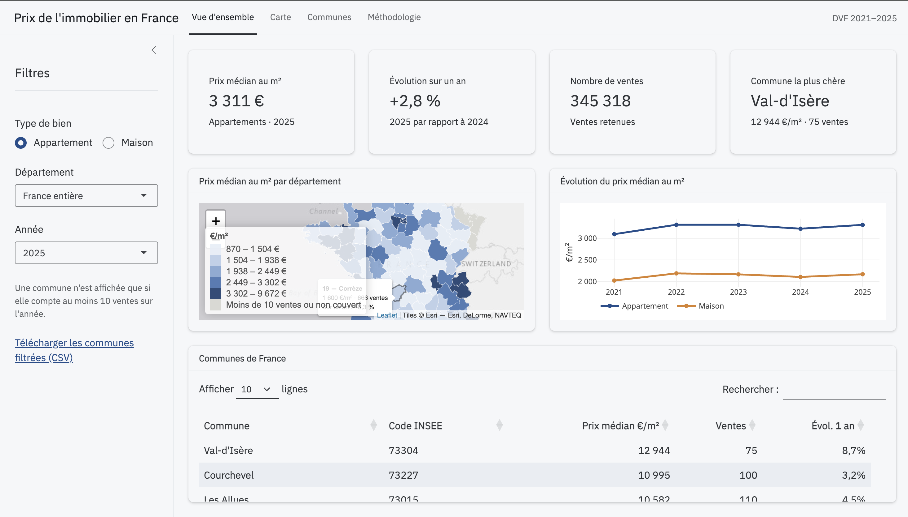

# Prix de l'immobilier en France (DVF)

Application R Shiny sur les prix des appartements et des maisons en France, par commune et par département, de 2021 à 2025.

**Application en ligne : [urielfagninou.shinyapps.io/immo-dvf-shiny](https://urielfagninou.shinyapps.io/immo-dvf-shiny/)**



## Contenu de l'application

- **Vue d'ensemble** : prix médian au m², évolution sur un an, nombre de ventes et commune la plus chère, avec filtres par type de bien, département et année. Carte des départements, courbes d'évolution et tableau des communes exportable en CSV.
- **Carte** : carte des départements ou des communes, colorée selon le prix médian, l'évolution sur un an ou le nombre de ventes. Un clic sur une commune affiche sa fiche résumée.
- **Communes** : fiche détaillée d'une commune ou d'un arrondissement. Courbe trimestrielle comparée au département, à la France ou à une autre commune, distribution des prix, prix selon le nombre de pièces, rang dans le département et historique annuel.
- **Méthodologie** : source, règles de préparation et limites.

## Données

[Demandes de valeurs foncières géolocalisées](https://www.data.gouv.fr/fr/datasets/demandes-de-valeurs-foncieres-geolocalisees/) (DGFiP, Etalab) et [contours administratifs](https://www.data.gouv.fr/fr/datasets/contours-administratifs/) (Etalab). DVF ne couvre ni l'Alsace, ni la Moselle, ni Mayotte.

Près de 3,9 millions de ventes sont retenues sur cinq fichiers annuels. Les règles de préparation :

- seules les ventes sont gardées ;
- une mutation peut regrouper plusieurs biens pour un prix global : on ne garde que celles qui portent sur un seul appartement ou une seule maison, sans local professionnel ;
- prix au m² = valeur foncière / surface réelle bâtie, surface d'au moins 9 m² ;
- les 1 % de prix au m² les plus bas et les plus hauts sont retirés, par département, type de bien et année ;
- les ventes des communes fusionnées sont rattachées à la commune actuelle (jointure spatiale avec les communes déléguées) ;
- Paris, Lyon et Marseille sont disponibles en commune entière et par arrondissement ;
- une commune n'est affichée pour une année que si elle compte au moins 10 ventes.

## Structure du dépôt

```
R/
  Telechargement.R   téléchargement des fichiers DVF annuels
  Preparation.R      filtrage des mutations et calcul du prix au m²
  Contours.R         contours des communes et départements, table de passage des communes fusionnées
  Agregation.R       agrégats par commune, département et France (annuels, trimestriels, par pièces, déciles)
app/
  app.R              application Shiny
  data/              agrégats et contours au format .rds
```

Les fichiers bruts (`data/raw/`) et intermédiaires (`data/interim/`) ne sont pas versionnés.

## Reproduire

```r
install.packages(c("data.table", "arrow", "sf", "shiny", "bslib", "leaflet", "plotly", "DT"))

source("R/Telechargement.R")
source("R/Preparation.R")
source("R/Contours.R")
source("R/Agregation.R")

shiny::runApp("app")
```

## Outils

R, data.table, arrow, sf, Shiny, bslib, leaflet, plotly, DT. Déploiement sur shinyapps.io.

## Auteur

Uriel Fagninou - Data analyst / Data scientist
